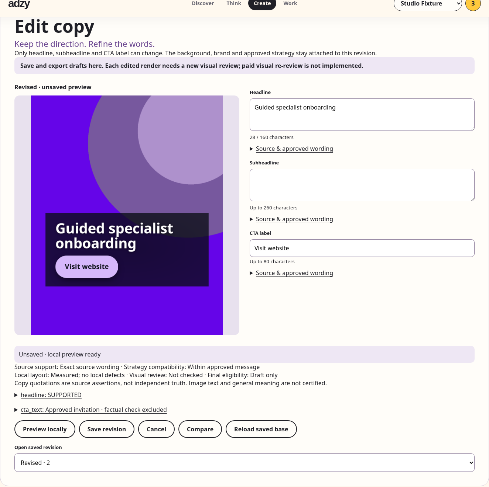

# Evidence-aware Copy Editor

Local implementation over published main `dbff34b197751fe1945e8cf9900ab0720cabe562`.

## User journey

Create → saved poster → **Edit copy** → edit headline, subheadline or CTA label → **Preview locally** → inspect source support and strategy compatibility → **Save revision** → **Compare** → reload → open saved revision → export draft.

The editor has a side-by-side desktop layout and a vertical 390px layout. Source quotations and page links expand per field. “Use source wording” only copies server-provided text; preview/save recompute its support. A quotation may be source-supported while outside the approved message. Original and Revised images and text are labeled separately. Unsaved text is scoped by account/brand/revision, expires after 24 hours and is invalidated at logout. A bounded buffer is restored after network failure; it never becomes a documented revision until the server saves it.



[Mobile editor screenshot](docs/images/copy-editor-mobile.png).

## Authority and persistence

No new revision, acceptance, evidence, job, billing table or schema migration. Each copy revision is an existing canonical poster `Run` with an `Attempt`, `Asset` and Gallery publication. The existing physical storage identity is reused if identical bytes already belong to the same brand; attempt identity, assessment and eligibility are always new.

- `editor_recipe`: structured full brief, design spec, rendering inputs, managed text-free background key/checksum/size/MIME, four font checksums and recipe hash. New canonical classic composition and editing use the same compositor and bundled Noto font policy. One-shot images and historical outputs without these inputs are explicitly unavailable for editing.
- `copy_revision`: parent Run/Attempt/checksum, original root, actor, copy/spec/background/recipe hashes, profile snapshot, strategy and contract IDs, explicit branch choice. The existing Run dependency retains `uses_strategy`; copy lineage uses existing JSONB rather than inventing a dependency relation or changing its database constraint.
- `editor_checks`: render SHA-256, measured local geometry/contrast and bounded repair history, visual-review state. Full factual assessment and strategy verification remain in their existing fields; Attempt.qa retains its own visual/strategy/acceptance checks.
- New saved edits have their own unchecked visual verdict. Original selection, acceptance and last accepted result are unchanged. No provider or telemetry is called by editing, previewing or saving.

The immutable contract comes from the saved canonical Run. Current profile, current exact strategy approval and the freshly rebuilt contract are rechecked before rendering and again under the Brand writer lock before commit. Browser requests cannot provide contracts, evidence IDs, assets, background paths, HTML, CSS, fonts or URLs. Existing exact-quotation, numeric, currency and factual policies are reused. Editable text must also remain in approved consumer message/proof/differentiation roles; the generic concept verifier alone would not prove that.

## API

All routes require authentication and ownership; absent/foreign subjects return 404.

| Route | Behavior |
|---|---|
| `GET /api/poster/runs/{id}/copy-editor` | Availability/reason, base identity hash, current family head, copy, source options, saved checks, revision list and authenticated preview. Raw render recipe is omitted from this response. |
| `POST /api/poster/runs/{id}/copy-preview` | Strict headline/subheadline/cta_text payload; local composition and fresh source/strategy/layout checks. No publication or paid work. |
| `POST /api/poster/runs/{id}/copy-revisions` | Copy plus expected base hash, expected head Run, idempotency key and optional explicit branch. Byte-first, atomic Run/Attempt/Asset/Gallery commit. |
| Existing `/delivery` and `/download` | Revalidate the exact selected revision, current approval, factual and visual bindings, editor layout/strategy/metadata and byte checksum. Draft and final remain distinct. |

Limits: headline 2–160, subheadline 0–260, CTA label 1–80 Unicode code points on the server. Browser limits report an error without truncating text. Extra properties are rejected. Idempotency compares the entire request, under the same Brand lock used by canonical writers. Response loss/double click returns one saved revision; changing a key's payload conflicts. Competing saves with an old family head conflict. Branching from an older revision requires an explicit checked action. Preview responses are fenced by session/brand/revision/input version.

## Rendering and security

Rendering loads only managed, checksum-verified background bytes and fixed source fonts, into a temporary directory. It calls the existing HTML compositor, local contrast gate, geometry inspection and at most one existing local repair. Browser network routes are aborted; CSP blocks scripts, remote fonts/images and connections. Input text is escaped by the compositor; UI user/source strings use DOM textContent/value. No browser input becomes markup or an executable command. Identical-background and font hashes persist after restart.

Background blobs are registered in the existing GalleryBlob repository, in addition to being retained in the recipe. Unavailable/changed inputs fail closed. Render failures return a specific error and create no incomplete successful revision; the client retains the input buffer. No failed render overwrites an accepted asset.

## Verification

- **337 distinct Python cases passed** across 23 scoped files; **21 distinct JavaScript cases passed**. Overlapping delivery reruns are not counted again. The editor contributes 14 cases: the final 13-case run plus the additional parent/profile case. Three final delivery cases were also repeated successfully from the source-only export.
- Baseline main: the behavioral save journey failed at editor context with HTTP 404. After implementation, independent-save/background reuse, immutable original/last accepted, exact quote versus unsupported numeric/quantifier/entity changes, source-supported but out-of-strategy copy, CTA promises, idempotency/concurrency/stale base/branching, ownership/substitution/stale strategy/profile, missing background, render failure, overflow and escaping/Bidi cases pass.
- Actual browser journey from the **source-only export**: accepted synthetic original → unsupported saved draft → source-matching correction → late-preview fence → local render → save → compare → refresh → application-process restart → saved checks → draft export. Simulated response loss saved exactly one revision. With complete fake QA fixture observations, final delivery passed. Both downloads matched SHA-256 `c0d399dbed65a1dbe05d1293961da43c322a37847d8971eb1b18a15bfbf79f82`. Zero page errors and zero provider dispatches. Screenshots were opened and inspected at desktop and 390px.
- Source exporter: **609 files after publication review**, zero credential-pattern findings, local documentation links resolved. Final source-only browser and targeted SQL tests ran without private data/runtime inputs. The original working tree status and index SHA-256 match their initial values.
- Early failures were resolved rather than hidden: a proposed dependency relation was not in the existing database vocabulary, so parent lineage stayed in JSONB; identical synthetic brands collided with the existing unique Asset key, so fixture backgrounds were differentiated; browser helper import/selector/sparse metadata errors were fixed; incomplete fake QA was rejected until its required text observations were supplied; the new routes were added to the authority registry, whose final 60 cases passed. No assertions or acceptance requirements were weakened.

Local raw evidence is retained under `docs/validation/copy-editor/` (`RESULT.json`, final pytest outputs, source-browser result, checksums and screenshots). These local logs are excluded from the public source-only package; the public screenshots and this report are included.

Commands (Docker with cached `postgres:16-alpine`, Python app requirements and Chromium required):

```bash
python -m pip install -r requirements-app.txt
python -m playwright install chromium
python -m workflows.verify -q tests/test_copy_editor.py
python tools/check_poster_v1.py --evidence-dir /tmp/poster-checks
python tools/verify_copy_editor_browser.py --directory /tmp/copy-editor-demo --evidence-dir /tmp/copy-editor-browser
python tools/prepare_app_publication.py /tmp/adzy-copy-editor-source
```

`workflows.verify` disables private dotenv loading, external provider/network access and telemetry. SQL tests provision only guarded disposable PostgreSQL. The browser fixture likewise uses loopback traffic and a disposable database, restarts the application process and verifies actual downloaded PNG SHA-256 values. CI includes the copy tests and browser journey. Source export includes the editor, bundled fonts/OFL notice, synthetic demo, tests, docs and screenshots.

## Boundaries

A source assertion is not independently verified truth. Exact quotation support does not certify paraphrases, general entailment, language quality or image text. Semantic shadow remains unqualified and is never activated. Source-supported copy outside the approved message still needs strategy review.

The application has no standalone paid re-review endpoint for an edited poster. This scope does not invent a new paid operation or reuse exhausted authorizations. Edited posters are fully usable saved local drafts, with draft export; paid vision review has not been executed. A real final download requires its own valid visual review and all existing delivery checks. The automated browser/test harness explicitly materializes fake QA fixtures only in its guarded synthetic database to prove the final delivery/checksum path. That fixture is not an application API, live review or human approval.

No full-suite, live provider quality, production deployment or semantic certification claim. No paid dispatch, owner reservation changes, external telemetry, Reel changes or deployment. Publication uses an isolated feature branch; the original working tree and index remain preserved.

saved draft editing complete; paid visual re-review not implemented.


## Publication review

The first source candidate had 1,152 files because it included the whole historical test tree and broad architecture evidence globs. The reviewed candidate has 609 files: release checks plus recursively imported local test helpers, application sources needed by the existing shell, four managed fonts, public docs/screenshots and explicit required calibration/source fixtures. Historical validation text/JSON, source manifests, local copy-editor logs, runtime stores, nested publication packages and symlink sources are excluded. The original files remain on disk. Behavioral packaging tests cover omissions, helper closure, local preservation and nested/linked scratch rejection.

Fake review materialization lives in `tests/copy_editor_review_fixture.py`, requires a guarded explicitly synthetic database and is invoked only by the browser test tool. No application route imports it. Copy preview/save schemas reject supplied QA, acceptance, selection or checks; a focused HTTP test checks these attempts and proves a new saved Attempt remains unchecked/unselected. The UI explicitly says draft saving/export are available, paid visual re-review is not implemented, and supplies no paid review control.

The repository includes one [saved synthetic draft sample](docs/results/copy-editor-draft.png) with [checksum and provenance](docs/results/copy-editor-draft.json). It is a fictional draft from the local compositor, not a live-quality result or final-review sample.

Publication checks: packaging 3/3 and JavaScript 21/21 passed; the actual updated desktop/390px browser journey passed with zero page errors and provider dispatches. It also asserts the explicit unavailable paid-review message and the absence of a visual-review action. The first concurrent local browser run hit a transport wait timeout on an overloaded host; the tool now waits up to 120 seconds for the same complete response-loss assertions. No acceptance requirement was changed. GitHub CI remains the publication gate for the final commit SHA.
