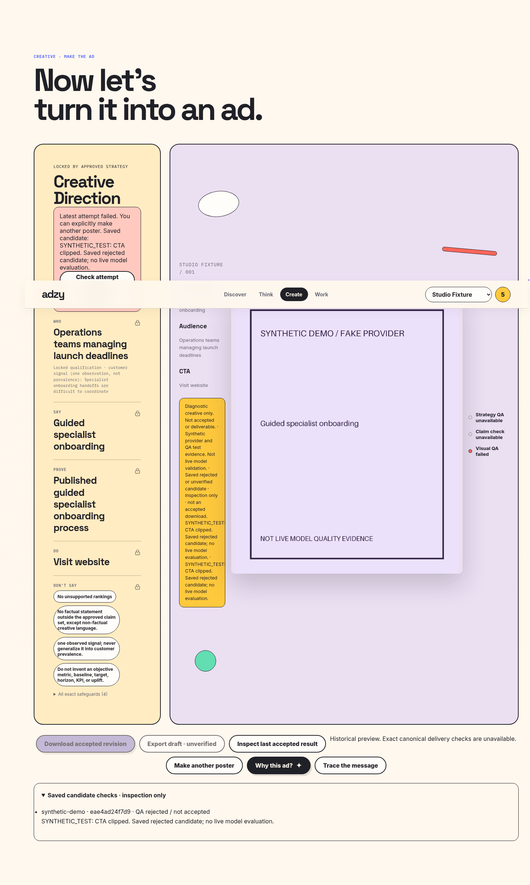

> Historical implementation/review report. The final public candidate excludes optional branded portfolio media and private case inputs. See README and THIRD_PARTY_ASSETS.md for actual distributed contents.

# Poster: economic local repair and retained QA

Offline source changes for review; no live provider execution or deployment.

The classic compositor makes at most one local revision per background before considering a background retry. Geometry, minimum proof/CTA typography and contrast are local checks; clipped or weak overlays reuse the background. Pure local failures stop after the bound. Background image failures remain separately gated. Every render has a distinct candidate ID and byte hash; local geometry is not visual model acceptance.

Actual production art direction now carries optional typography controls and photography/illustration/typography through its structured output and image prompt. No Firefox or shield treatment was added to the shared renderer. Bidi/source casing and contrast controls remain in the compositor.

Arabic QA policy2 is scoped to exact evidenced names from the authoritative contract, its prompt, transcript and interpretation. Unexpected Latin and missing/ambiguous role review fail. The model aggregate is retained; an explicit veto stays rejected. Graphic media are judged against the selected medium. Historical policy1 records are not rewritten.

Each candidate is byte-first stored through the existing gallery object store, then checkpointed in the existing Attempt.qa JSONB with structured QA, reason, policy/context, identity, spec/local checks and background digest. No schema migration, new business authority, acceptance flag override or raw prompt logging. Contacts/URLs/credentials are redacted from owner-visible metadata. A failure finalization preserves the history. Authenticated candidate preview is inspection only; it does not create an accepted Asset or exact download. The UI restores it and its reasons after refresh. Historical missing Firefox QA is not reconstructed.

The original Arabic operation remains12/12/failed with its$2 reservation unchanged. Two actual generated rejected images, a manually directed local revised preview, and a complete synthetic app journey are distinctly labeled in README/demo. No inference about live quality follows from fake responses.

## Measured verification — 2026-10-18

Release validation used fresh processes from the clean source candidate, disposable PostgreSQL and fake transports. 264 Python cases across19 focused groups passed after two packaging/test-fixture corrections; the16 existing one-shot cases also passed. Frontend19 passed. No full repository suite was run.

The first candidate check exposed an obsolete unknown-policy fixture (version2 is now supported); it now uses genuinely unknown version999. The source exporter also omitted an imported canonical-contract test fixture and its synthetic raster PNG. Both dependencies are now explicitly exported. Acceptance was not relaxed. The initial failures remain in local evidence; only the affected files/case were rerun.

Visual inspection of the initial browser screenshot exposed a real refresh race: a late review restoration replaced the diagnostic with an older draft. A behavior test reproduced the fault before the fix and passed after it. Operation projection now retains the protected diagnostic when the late review restores the same active view; deliberate selection of an older accepted revision remains supported.

The final real-browser journey passed desktop/mobile strategy approval, accepted synthetic exact download/checksum, refresh, cross-owner404, rejected candidate/reason restoration, disabled final export, draft409 and deliberate older-revision selection. No page errors. Screenshots carry a synthetic/fake-provider label; the review of their PNGs is AI visual inspection, not live vision QA or human review.

[Mobile screenshot](docs/images/app-synthetic-rejected-mobile.png). Synthetic accepted download checksum: `eae4ad24f7d9162f43b3fd2b99dc3152c97cbd78c1d18f11cf021b05644e880d`; browser bytes matched. This proof applies to the fictional synthetic asset only.

A final read-only database comparison found all12 original UsageRecords (including estimates/usage/state), both original approvals and timestamps, operation terminal state/reservation/accounting and frozen plan hash unchanged. The same existing stopped container was briefly started for this read and returned to stopped; the operation was never reopened. New actual provider calls0, additional billed activity initiated0; historical invoice remains unknown. Reservation$2 and estimate$0.436428800 remain recorded, not released or settled.

## Review source and remaining live check

The clean-source exporter includes public source, locks, migration history, reproducible checks, labeled screenshots and the saved local preview inputs/assets. It excludes private state, authorizations, credentials and runtime databases. `PUBLICATION_MANIFEST.json` records each included file checksum, the limited secret-pattern scan and documentation-link results. A passing pattern scan is not a general security certification.

These changes are ready for source review and later deployment preparation; no deployment occurred. A separately authorized future operation must still exercise the revised prompt/structured QA with a real model and demonstrate actual visual/factual acceptance on its own bytes. The exhausted Firefox operation supplies no quota or approval for that experiment. No provider calls, Reel changes, semantic qualification, commit/push/deploy.
