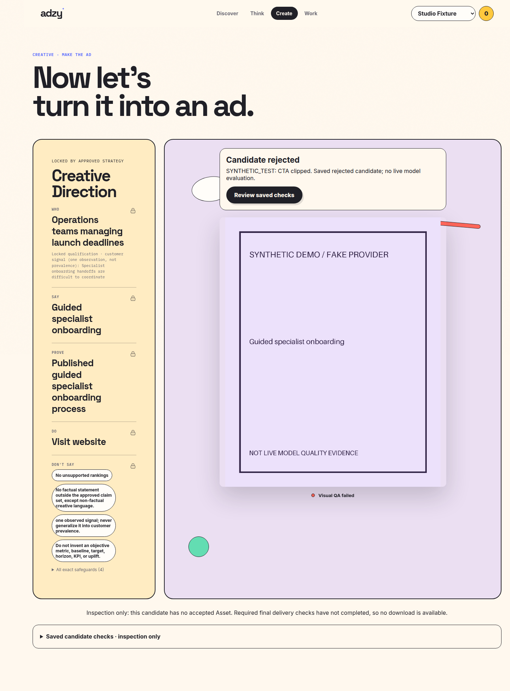
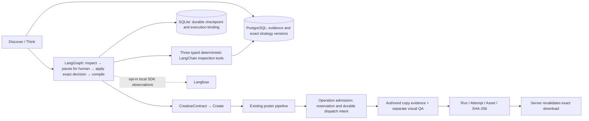

# ADZY — from evidence to a poster you can inspect

ADZY turns brand evidence into a reviewable strategy, carries the approved direction into a poster, and binds its download to the exact saved image. **Discover → Think → review SWOT → review Strategy → Create → inspect checks → download.**


*Actual app screenshot with fictional data and fake provider/QA responses; no live model-quality claim.*

| Evidence | What happened / public contents |
|---|---|
| Complete synthetic app journey | Real app/auth/review/recovery/persistence/download gates, fictional inputs and fake provider/QA responses. Runnable public demo and labeled screenshots included. |
| Historical live Firefox generation | Two actual generated/composited renders, both rejected;12/12 exhausted, no accepted canonical Asset/download. Images remain local and are excluded from this public package. |
| Improved local preview | Manually directed offline portfolio composition, not independent system-selected design or canonical acceptance. Original media/inputs remain local and are not redistributed. |

The poster path now gives local layout defects one bounded recomposition of the **same background** before considering a new image. New renders receive their own candidate identity, checksum and checks. Clipping, proof size, text contrast and Bidi are compositor concerns; background defects remain separately gated. A persisted rejection or unverified candidate can be inspected after refresh without enabling an accepted download. Exact evidenced brand names are scoped in Arabic QA; unrelated or ambiguous Latin remains blocking, and an explicit model veto is never reopened locally. Photography, illustration and typography are art-direction inputs, not one universal privacy/Firefox template.


*Actual browser capture: fake-provider candidate and rejection restored after refresh; accepted export disabled. [Mobile capture](docs/images/poster-v1-final-rejected-mobile.png). [Implementation and verification](POSTER_ECONOMIC_REPAIR_RESULT.md).*

Prepared separate-checkout status: **READY_TO_COMMIT_AND_PUSH**. [Closeout, CI and proposed commit](POSTER_V1_PUBLICATION_REVIEW.md) · [Asset provenance and rights review](THIRD_PARTY_ASSETS.md). The rejected-candidate UI now exposes only available actions; mobile account/navigation bars stay in the page flow.

## Run it locally

Prerequisites: Linux, Python3.12, Docker and Node.js22 for release checks. Install the application lock in an isolated environment:

```bash
python3 -m venv .venv-app
source .venv-app/bin/activate
python -m pip install -r requirements-app.txt
python -m pip check
python -m playwright install --with-deps chromium
docker pull postgres:16-alpine
```

The public demo uses fictional **Studio Fixture** data and project-authored synthetic assets, not Firefox artwork or private customer material. [Setup, credentials, cleanup and capture options](docs/demo/README.md).

## Reproduce the complete offline download journey

The fictional demo has explicit fake image/QA responses so a reviewer can exercise the whole application without a paid account:

```bash
python -m workflows.app_demo init --directory .review-app-demo
python -m workflows.app_demo serve --directory .review-app-demo --port 8000 --synthetic-posters accepted
```

Open [the offline demo](http://127.0.0.1:8000/app). Use the email printed by `init` and `SyntheticDemo42`. Choose **Think → Review strategy → Lock this strategy → Prepare the poster → Generate**, inspect the copy evidence and use **Download accepted revision**. Fictional evidence and simulated provider responses are labeled. Automated review decisions in release tests are simulations, not human labels or live quality evidence.

Restart with `--synthetic-posters draft` to inspect an unresolved draft beside the last accepted revision. Refresh retains the selected revision. Final download is refused for drafts; **Export draft · unverified** is a separate action. Cleanup after stopping this disposable server:

```bash
python -m workflows.demo cleanup --directory .review-app-demo
```

## What is implemented



LangGraph pauses at an actual review interrupt, resumes the same subject after restart, and delegates decisions to canonical PostgreSQL services. The three typed LangChain tools inspect the subject, research readiness and creative requirements; there is no model-driven tool-selection loop. Approving a newer strategy never silently approves an older one. An explicit restart of an undecided review can recover after the missing SWOT approval is supplied; it does not create a strategy approval.

Every creative operation retains its own request key, reservation and dispatch records. The bounded live policy freezes provider/model/stage routes and input/output limits, permits at most12 sends per case, and commits each intent before transport. SDK attempts are1; failed requests consume slots and ambiguous outcomes stop without blind fallback. Recovery reads the existing operation rather than rotating its key. Monetary reservations use estimates, not hard invoice guarantees.

Copy assessment retains source excerpts and page URLs bound to the actual authored copy, Attempt and image bytes. Literal supported quotations can qualify; unresolved factual wording remains a draft. Visual QA and source support are separate. The experimental semantic assessment remains **shadow/unqualified**. The ordinary factual gate does not certify pixel text; AI inspection of the local Arabic proposal is labeled separately.

**Download accepted revision** rechecks current profile/strategy approval, factual eligibility, required visual checks and the exact managed Asset/checksum. Browser release checks compare the downloaded file to the server checksum and verify refresh, cross-owner denial and draft refusal.

Langfuse SDK observations have been tested through local capture, redaction and exporter-failure handling. Hosted/server ingestion is unverified. External telemetry is disabled by default in the supplied demos. PostgreSQL owns business decisions; SQLite owns workflow progress. Use one application instance and persist both stores plus managed blobs.

## Live execution and limits

The accounting below is historical evidence from the owner’s local workspace. That operation, its approvals and private state are not bundled in this public demo.

Live execution requires explicit financial authorization and exact human strategy decisions. These are already recorded for the existing Arabic case; do not reinitialize it, regenerate its plan, or repeat approval. The unchanged Vertex/ADC/global operation used12/12 dispatches (`gemini-3.5-flash-lite` text/vision and `gemini-2.5-flash-image` backgrounds), with a retained$2 reservation and$0.436428800 in call estimates; invoice unknown. Compiler recovery preserved the reviewed assertions and source anchors. Two real renders failed Visual QA; no canonical Asset or final download exists (delivery404). The server is back in no-spend mode. See [historical text-only compiler result](docs/experiments/poster_compiler_source_support_20261018/RESULT.md) and [demo instructions](docs/demo/README.md); the old approval-pending screenshot/packets are historical. No further sends or replacement operation are authorized by this README.

V1 qualifies the Poster journey. Existing Reel/video/Veo code is retained outside this scope. No deployment, production certification, general semantic guarantee or campaign-performance claim is made. Existing authentication is demo-grade; distributed workers are not certified.

## Verify and prepare source

Run the established release checks once after changes stabilize:

```bash
python tools/check_poster_v1.py --evidence-dir /tmp/poster-v1-checks
python tools/verify_poster_v1_browser.py --directory /tmp/poster-v1-demo --evidence-dir /tmp/poster-v1-browser
python tools/prepare_app_publication.py /tmp/adzy-poster-v1-source
```

Checks use fresh processes, guarded disposable PostgreSQL, real application authentication/services, fake external transports and browser downloads. They include dispatch limits/concurrency, review recovery, Arabic compositor alignment, exact delivery and frontend behavior. These targeted checks are separate from the repository-wide/private-data suite. The source export includes code, application locks, migrations, supported checks, fictional public demo inputs, tests and labeled synthetic screenshots; it excludes private credentials, runtime databases, checkpoints, customer media and Git metadata.

Schema head is **0007_unused_reservations**. For an independently configured application, privately set `PERSISTENCE_BACKEND=postgres`, `BASEERA_DATABASE_URL`, an absolute `BASEERA_WEBAPP_DIR` and persistent `ADZY_REVIEW_STATE_DIR`; run `python -m alembic upgrade head`, then `python -m uvicorn api.main:app --host 127.0.0.1 --port 8000`. Startup refuses a mismatched schema. The [application architecture](docs/architecture/app_review.md) describes the exact review/recovery boundary; the [publication checklist](docs/architecture/app_publication.md) covers dependencies and source packaging.

Existing authorship is retained; no license terms are changed or added.
