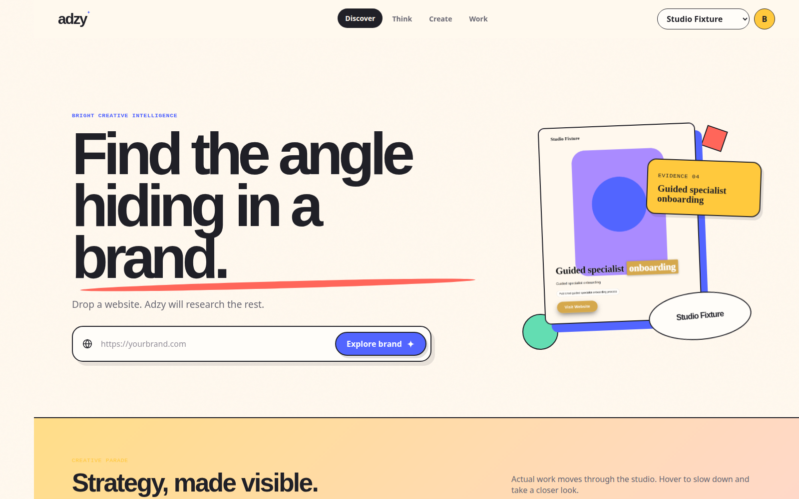
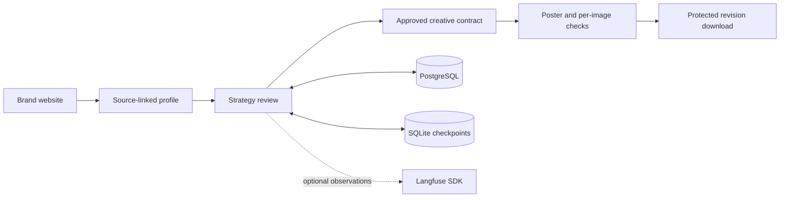

# ADZY

**Turn brand evidence into a strategy your team can review—and creative you can trace.**

Marketing teams and small agencies often move from scattered website research to creative production without a clear record of why a message was chosen. ADZY brings that workflow into one application: research a brand, inspect the evidence, approve an exact strategy, then create and review a poster tied to that decision.

**Brand URL → source-linked profile → strategy review → poster → checked download**


*The running application, captured with fictional Studio Fixture data, a project-authored poster fixture and simulated provider/QA responses. This demonstrates the product workflow, not live model output quality.*

## What the product does

- Builds a brand profile with source quotations and page URLs, then presents research and strategic directions for review.
- Records SWOT and strategy decisions against exact versions; paused reviews can recover without inventing or repeating approval.
- Carries the approved message, evidence and constraints into poster production. Local overlay defects get one bounded recomposition of the same background before a new background is considered.
- Keeps image-specific QA and rejection reasons after refresh. Accepted downloads revalidate ownership, current approvals, required checks and the exact saved bytes; drafts and rejected previews remain separate.

## Architecture



| Integration | Its role in ADZY |
|---|---|
| **LangGraph** | Persists the review state, pauses for a human decision and resumes the same subject after restart. PostgreSQL services remain the authority for approval. |
| **LangChain** | Three typed inspection tools check the review subject, research readiness and creative requirements. Tool execution is deterministic; this is not an autonomous model-driven planning loop. |
| **Langfuse** | Optional SDK observations with local capture, redaction and exporter-failure handling. External telemetry is disabled in the supplied demo. |

PostgreSQL stores business versions, decisions, operations and assets. SQLite stores review checkpoints. [Architecture and recovery details](docs/architecture/app_review.md).

## Verified behavior

The [offline CI workflow](https://github.com/asmaasamyhagag22-design/adzy/actions/workflows/poster-v1.yml) reports the following results for one run of the selected checks:

| Checks | Result |
|---|---|
| Python | **320 passed** across 22 focused groups |
| JavaScript interface behavior | **21 passed** |
| Actual browser journey | **Desktop and mobile passed**: review, refresh/recovery, rejected previews, cross-owner refusal, draft/final separation and download checksum matching |

These are targeted application checks with fake provider transports and disposable PostgreSQL—not the repository-wide suite or a measurement of live model quality. [Recorded CI run](https://github.com/asmaasamyhagag22-design/adzy/actions/runs/39163997942). Separate push/PR runs and earlier local checks are not added together.

## Run the public demo

Requires Python 3.12, Docker and Playwright Chromium on Linux. Node.js 22 is needed for the interface checks.

```bash
python3 -m venv .venv-app
source .venv-app/bin/activate
python -m pip install -r requirements-app.txt
python -m pip check
python -m playwright install --with-deps chromium
docker pull postgres:16-alpine
python -m workflows.app_demo init --directory .review-app-demo
python -m workflows.app_demo serve --directory .review-app-demo --port 8000 --synthetic-posters accepted
```

Open [localhost:8000/app](http://127.0.0.1:8000/app). Sign in with the email printed by `init` and `SyntheticDemo42`, then choose **Think → Review strategy → Lock this strategy → Prepare the poster → Make the ad**. The demo uses fictional data and simulated responses; no provider account or private dataset is required.

After stopping the server, clean up its disposable database:

```bash
python -m workflows.demo cleanup --directory .review-app-demo
```

[Draft/rejected modes and local SDK capture](docs/demo/README.md) · [Application setup and migrations](docs/getting-started.md) · [Asset provenance and notices](THIRD_PARTY_ASSETS.md)

To run the same focused checks locally:

```bash
python tools/check_poster_v1.py --evidence-dir /tmp/poster-v1-checks
python tools/verify_poster_v1_browser.py --directory /tmp/poster-v1-demo --evidence-dir /tmp/poster-v1-browser
```

## Current limits

- The synthetic journey verifies application behavior. Two historical live Firefox renders were visually rejected; a later manually directed local preview was not canonical acceptance. Those optional media remain excluded from the public package.
- Semantic assessment remains experimental, **shadow/unqualified**, with no acceptance authority. Literal copy/source checks do not certify image pixels, general meaning or independent truth.
- Langfuse SDK behavior has local test coverage; **hosted/server ingestion is not verified**.
- Live generation requires separate credentials and explicit financial authorization. Estimates are not invoice guarantees; unknown provider outcomes stop without blind retries.
- The supported setup is one application instance with persistent PostgreSQL, managed blobs and SQLite review state. Demo authentication is not a production security certification.

Existing authorship and third-party notices are retained. No new repository-wide license grant is implied.
