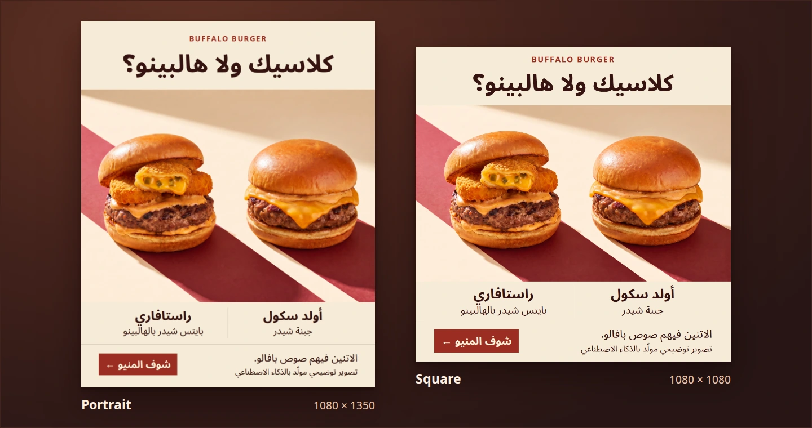
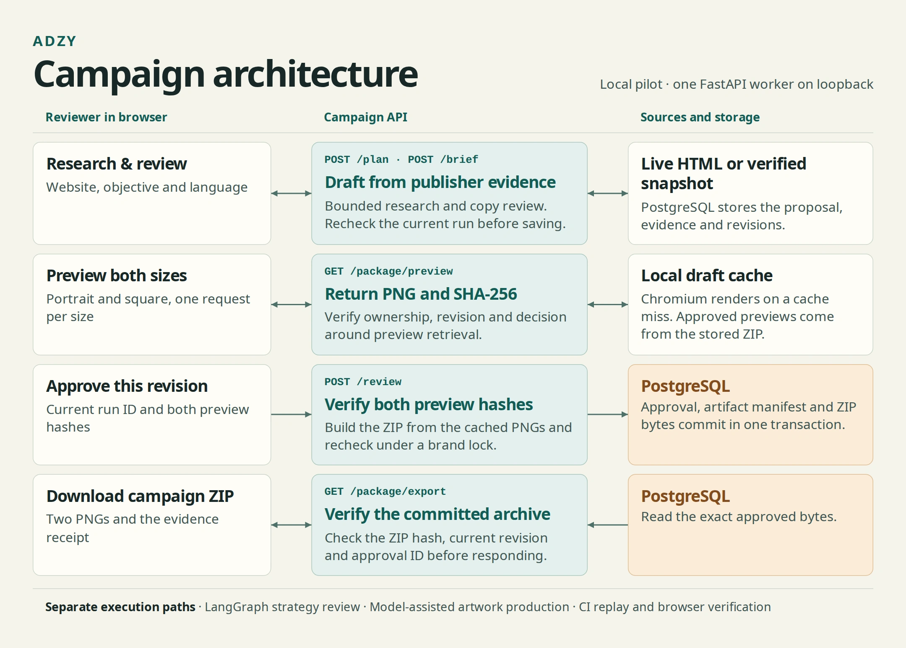

# ADZY

**Campaign briefs backed by publisher evidence, with approval tied to the exact poster files.**

Start with a brand website, an objective, and Arabic or English. ADZY drafts a source-linked brief. A reviewer checks the copy, previews both poster sizes, and approves a specific revision. The download contains both PNGs and a JSON receipt linking the creative to its sources and approval.

[Campaign showcase](#campaign-showcase) · [Architecture](#architecture) · [Verification](#verification) · [Run locally](#run-locally)

<a name="campaign-showcase"></a>

## Buffalo Burger · كلاسيك ولا هالبينو؟

<picture>
  <source media="(max-width: 600px)" srcset="docs/campaigns/buffalo/portfolio/poster-portrait-390.png">
  
</picture>

[Portrait PNG](docs/campaigns/buffalo/portfolio/poster-portrait.png) · [Square PNG](docs/campaigns/buffalo/portfolio/poster-square.png) · [Campaign ZIP](docs/campaigns/buffalo/portfolio/campaign.zip) · [Evidence and approval receipt](docs/campaigns/buffalo/portfolio/campaign.json)

This independent portfolio concept uses curated Arabic copy, captured publisher text, and illustrative artwork previously generated with Gemini on Vertex AI. The demo composes the saved scene. The automatic planner produces source-led briefs and generic artwork, as shown in the frozen Five Guys and Nando’s cases. [Art direction and provenance](docs/campaigns/buffalo/portfolio/REVIEW.md) · [Automatic examples](https://github.com/asmaasamyhagag22-design/adzy/blob/04202954503bc1a80bf3a9f43e5d42cb89f9fb7f/docs/campaigns/buffalo/review/README.md)

<a name="engineering"></a>

## Architecture

<picture>
  <source media="(max-width: 760px)" srcset="docs/images/campaign-architecture/overview-mobile.webp">
  
</picture>

The diagram shows the local Campaign pilot. Route labels are shortened under `/api/v2/campaigns`, with `{domain}` on routes for an existing brand. Draft previews use a local cache. Approval binds both preview hashes and the revision to a ZIP stored in PostgreSQL. Approved previews and downloads read that archive. [Full-size diagram](docs/images/campaign-architecture/overview.webp) · [Request sequence and failure boundaries](docs/campaigns/transformation/ARCHITECTURE.md)

The Campaign planner uses bounded research and deterministic copy policies. A separate strategy review workflow uses LangGraph with a human interrupt and SQLite checkpoints. Campaign logs carry trace IDs, and configured application deployments can opt into redacted Langfuse spans. [Strategy-review architecture](docs/architecture/app_review.md)

## Review in ADZY

<picture>
  <source media="(max-width: 600px)" srcset="docs/images/campaign-showcase/campaign-review-mobile.webp">
  
</picture>

The approved revision in the local app. Reviewers can open the exact publisher quotes and inspect the active copy before downloading the package. [Screenshot provenance](docs/images/campaign-showcase/README.md)

<a name="engineering-evidence"></a>

## Verification

| What was exercised | Observed outcome |
| --- | --- |
| A neighboring paragraph qualifies a claim | The synthetic context suite improved from 6/10 to 10/10 expected outcomes. The tracker case retained the qualifier and switched to source-guide copy. [Evaluation cases](docs/campaigns/transformation/replay-outcomes.json) |
| A fault drops nearby qualifiers | The frozen evaluator returned `KEEP_STABLE` with exit code 1. [Fault injection result](docs/campaigns/transformation/REPORT.md#measured-changes) |
| A reviewer changes direction after approving | The earlier revision’s export returns HTTP 409. [Browser verification](docs/images/campaign-showcase/verification.json) |
| The preview cache is missing after a database restore | The run recovers the same approved ZIP bytes from PostgreSQL. [Recovery drill](docs/campaigns/transformation/pilot-drill.json) |

The Campaign replay and PostgreSQL/Chromium journey both passed in GitHub Actions at `0420295`. The same revision’s Poster V1 job stopped at source-package link validation. The packaging repair and both synthetic browser journeys have passed locally. These checks cover the single-operator pilot and frozen evaluation cases. [Campaign run](https://github.com/asmaasamyhagag22-design/adzy/actions/runs/43649966314) · [Poster V1 run](https://github.com/asmaasamyhagag22-design/adzy/actions/runs/43649966372) · [Evaluation limits](docs/campaigns/transformation/REPORT.md)

<a name="replay-from-a-clean-checkout"></a>
<a name="replay-buffalo-from-a-clean-checkout"></a>

## Run locally

Run from the repository root on Linux with Python 3.12, Docker, and Playwright Chromium. The snapshot demo uses disposable PostgreSQL, captured publisher pages, and stored artwork. It makes zero paid model calls.

```bash
python3.12 -m venv .venv
source .venv/bin/activate
python -m pip install -r requirements-app.txt
python -m playwright install chromium
docker pull postgres:16-alpine

demo_dir=$(mktemp -d)/demo
python -m workflows.public_campaign_demo init --directory "$demo_dir"
ADZY_CAMPAIGN_EDITIONS_FILE="$PWD/docs/campaigns/buffalo/portfolio/edition.json" \
  python -m workflows.public_campaign_demo serve --directory "$demo_dir" \
  --snapshot docs/demo/campaign-snapshots/buffalo --port 8020
```

1. Open [the local app](http://127.0.0.1:8020/app) and sign in with the credentials printed by `init`.
2. Open **Campaign**. Enter `https://buffaloburger.com`, set the objective to `تشجيع المستخدم على تصفّح المنيو واختيار برجر يناسبه`, and select Arabic.
3. Review the publisher quotes and campaign directions. In **تعديل نص الاتجاه**, try the reviewed message `الاتنين فيهم صوص بافالو.`. Save the brief, preview both sizes, approve the current revision, and download the ZIP.
4. Stop the server and run the same `serve` command with the same directory to check recovery. After stopping the demo, run `python -m workflows.public_campaign_demo cleanup --directory "$demo_dir"`.

If Chromium needs system libraries, run `python -m playwright install-deps chromium`. For an exported source bundle without Git metadata, set `ADZY_CAMPAIGN_BUILD_COMMIT` to the full SHA of the checked-out source used to create the bundle before running the evaluator.

<details>
<summary><strong>Verify the browser journey and release gate</strong></summary>

```bash
check_dir=$(mktemp -d)
ADZY_CAMPAIGN_EDITIONS_FILE="$PWD/docs/campaigns/buffalo/portfolio/edition.json" \
  python tools/verify_public_campaign_browser.py --directory "$check_dir/demo" \
  --evidence-dir "$check_dir/browser" \
  --snapshot docs/demo/campaign-snapshots/buffalo \
  --planner-cases docs/campaigns/buffalo/portfolio/case.json

python -m workflows.campaign_eval --output "$check_dir/replay.json"
```

Omit `--snapshot` to test current source retrieval. Add `--check-destination` to open the live menu in Chromium. A fresh run creates its own review identifiers. The restart check compares the recovered ZIP with the export from that run.

</details>

<a name="local-pilot"></a>

## Operating scope

The verified deployment profile is one trusted operator using one loopback worker. The runbook covers account setup, backup and restore, local monitoring, and rollback. [Operations runbook](docs/campaigns/transformation/OPERATIONS.md) · [Risk register](docs/campaigns/transformation/RISKS.md) · [Technical walkthrough](docs/campaigns/INTERVIEW.md)
