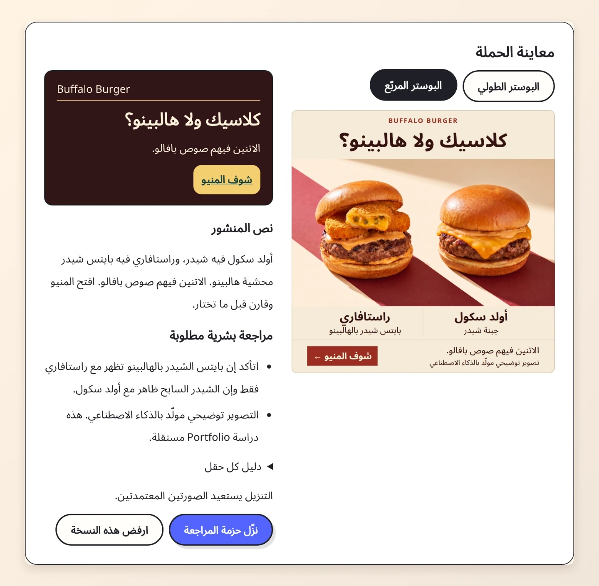

# ADZY

**Campaign research, review, and creative delivery.**

Turn a brand website and campaign objective into a reviewed brief and an approved poster package.

[Review in ADZY](#review-in-adzy) · [Run locally](#run-locally) · [Engineering](#engineering)

<a name="campaign-showcase"></a>

## Buffalo Burger · كلاسيك ولا هالبينو؟

<picture>
  <source media="(max-width: 600px)" srcset="docs/campaigns/buffalo/portfolio/poster-portrait-390.png">
  
</picture>

[Portrait PNG](docs/campaigns/buffalo/portfolio/poster-portrait.png) · [Square PNG](docs/campaigns/buffalo/portfolio/poster-square.png) · [Campaign ZIP](docs/campaigns/buffalo/portfolio/campaign.zip) · [Evidence receipt](docs/campaigns/buffalo/portfolio/campaign.json)

This independent Arabic campaign concept compares Old School and Rastafari and leads to the official menu. It uses reviewed copy, captured publisher evidence, and illustrative artwork generated with Gemini on Vertex AI. The local demo composes the saved artwork. [Art direction and provenance](docs/campaigns/buffalo/portfolio/REVIEW.md)

## Review in ADZY

<picture>
  <source media="(max-width: 600px)" srcset="docs/images/campaign-showcase/campaign-review-mobile.webp">
  
</picture>

The approved Buffalo revision in the local app. Reviewers can inspect the source quotes, switch poster formats, and download the two approved images and their evidence receipt. [Browser verification](docs/campaigns/transformation/browser-results.json) · [Image provenance](docs/images/campaign-showcase/README.md)

[Five Guys and Nando’s](docs/campaigns/buffalo/review/README.md) show the automatic path with generic artwork and source-led copy. [Additional Arabic and English diagnostics](docs/campaigns/transformation/REPORT.md#public-source-diagnostics)

<a name="replay-from-a-clean-checkout"></a>

## Run locally

Use Linux, Python 3.12, Docker, and Playwright Chromium. Run these commands from the repository root. The snapshot demo starts a disposable PostgreSQL instance on loopback, uses stored scenes and captured publisher evidence, and makes zero paid model calls.

```bash
python3.12 -m venv .venv
source .venv/bin/activate
python -m pip install -r requirements-app.txt
python -m playwright install chromium
docker pull postgres:16-alpine

demo_dir=$(mktemp -d)/demo
python -m workflows.public_campaign_demo init --directory "$demo_dir"
ADZY_CAMPAIGN_EDITIONS_FILE="$PWD/docs/campaigns/buffalo/portfolio/edition.json" \
  python -m workflows.public_campaign_demo serve --directory "$demo_dir" \
  --snapshot docs/demo/campaign-snapshots/buffalo --port 8020
```

1. Open [the local app](http://127.0.0.1:8020/app) and sign in with the credentials printed by `init`.
2. Open **Campaign**. Enter `https://buffaloburger.com`, set the objective to `تشجيع المستخدم على تصفّح المنيو واختيار برجر يناسبه`, and select Arabic.
3. Review the publisher quotes and campaign directions. In **تعديل نص الاتجاه**, try the reviewed message `الاتنين فيهم صوص بافالو.`. Save the brief, preview both sizes, approve the current revision, and download the ZIP.
4. Stop the server and run the same `serve` command with the same directory to check recovery. After stopping the demo, run `python -m workflows.public_campaign_demo cleanup --directory "$demo_dir"`.

If Chromium needs system libraries, run `python -m playwright install-deps chromium`.

<details>
<summary><strong>Verify the browser journey and release gate</strong></summary>

```bash
check_dir=$(mktemp -d)
ADZY_CAMPAIGN_EDITIONS_FILE="$PWD/docs/campaigns/buffalo/portfolio/edition.json" \
  python tools/verify_public_campaign_browser.py --directory "$check_dir/demo" \
  --evidence-dir "$check_dir/browser" \
  --snapshot docs/demo/campaign-snapshots/buffalo \
  --planner-cases docs/campaigns/buffalo/portfolio/case.json

python -m workflows.campaign_eval --output "$check_dir/replay.json"
```

Omit `--snapshot` to test current source retrieval. Add `--check-destination` to open the live menu in Chromium. A fresh run creates its own review identifiers. The restart check compares the recovered ZIP with the export from that run.

</details>

<a name="engineering-evidence"></a>

## Engineering

The Campaign planner uses bounded web research and deterministic copy rules. A curated edition can supply reviewed copy and scene assets. FastAPI checks ownership and revisions. PostgreSQL stores decisions and approved archives, and Chromium composes the previews.

| Scenario | Verified behavior |
| --- | --- |
| A nearby paragraph qualifies a claim | The review retains the qualifying span and uses source-guide copy for the reproduced tracker case. [Context evaluation](docs/campaigns/transformation/replay-outcomes.json) |
| A brief assigns jalapeño to Old School | The curated edition rejects the edit with HTTP 409 and identifies the field. [Rejection](docs/campaigns/buffalo/portfolio/rejected.json) |
| A reviewer changes direction after approval | The previous revision’s export returns HTTP 409. [Browser run](docs/campaigns/transformation/browser-results.json) |
| The preview cache is lost | PostgreSQL restore recovers the approved ZIP byte for byte. [Recovery drill](docs/campaigns/transformation/pilot-drill.json) |

[Architecture and decisions](docs/campaigns/transformation/ARCHITECTURE.md) · [Technical walkthrough](docs/campaigns/INTERVIEW.md) · [Evaluation and limits](docs/campaigns/transformation/REPORT.md)

ADZY also has a separate LangGraph strategy-review workflow with persisted checkpoints and human review. [Strategy-review architecture](docs/architecture/app_review.md)

## Local pilot

The [operations runbook](docs/campaigns/transformation/OPERATIONS.md) covers the single-worker, loopback Campaign service, explicit account provisioning, PostgreSQL backup and restore, and measured local limits. [Architecture and decisions](docs/campaigns/transformation/ARCHITECTURE.md) · [Risk register](docs/campaigns/transformation/RISKS.md)
