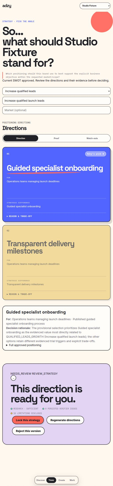
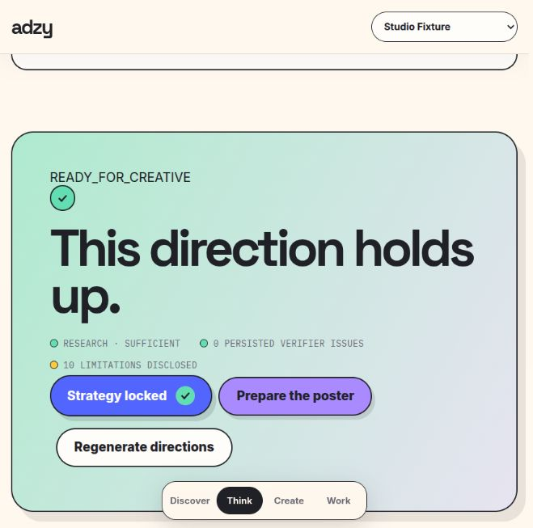
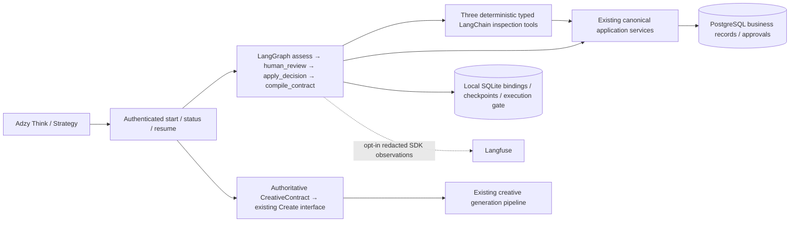

# ADZY — evidence-led marketing strategy and creative review

ADZY helps marketers and brand owners turn a business URL into a sourced brand profile, competitor research, SWOT, positioning, content calendars, media plans, and creative assets. Inputs include a URL, an explicit business objective, source evidence and human decisions. Outputs retain source references, unknowns, exact strategy approvals and creative constraints; evidence lineage does not guarantee factual correctness or campaign performance.

A typical journey is **Discover → Think → review SWOT → review Strategy → Create → Work**. The existing Adzy Strategy interface now starts a real LangGraph execution, pauses for a human decision, and resumes the same workflow to compile a CreativeContract. A newer strategy needs a fresh review. Create uses that contract and the existing generation pipeline.


*Actual application shell, fictional Studio Fixture evidence, real authentication and disposable PostgreSQL. The review graph is paused at its human decision. No live market research or customer result is shown.*


*Actual UI after an application restart and a decision through the same workflow. PostgreSQL contains one approval for the reviewed subject. This is review readiness, not generated campaign performance.*

## Architecture



- **LangGraph** orchestrates research readiness, exact-version review, canonical decisions and contract compilation through application routes. It stops at creative readiness.
- **LangChain tools** execute three typed, deterministic inspections. No model selects tools and no autonomous agent loop is claimed.
- **Langfuse** receives explicit SDK observations only when enabled. Local SDK capture verifies correlation, redaction and exporter-failure isolation. Hosted/server ingestion is unverified. Default operation performs no external telemetry export; deterministic nodes have no invented tokens or model costs.
- **PostgreSQL** owns users, profiles, strategy Runs and approvals. **SQLite** owns local workflow progress. Single-instance local persistence and cross-process restart are supported; distributed execution is not certified.

See the [application architecture and recovery protocol](docs/architecture/app_review.md), [compiled graph](docs/architecture/review_graph.mmd) and [integration evidence](APP_GRAPH_INTEGRATION_RESULT.md).

## Credential-free graph demo

Prerequisites: Linux, **Python 3.12**, Docker daemon, public `postgres:16-alpine` image. Installation needs internet; execution uses fictional evidence, local files and loopback PostgreSQL. It does not load private `.env`, call providers, scrape websites or generate media.

```bash
python3 -m venv .venv-workflow
source .venv-workflow/bin/activate
python -m pip install -r requirements-workflow.txt
python -m pip check
docker pull postgres:16-alpine
python -m workflows.demo init --directory .review-demo
python -m workflows.demo start --directory .review-demo
python -m workflows.demo resume --directory .review-demo --decision approved
python -m workflows.demo status --directory .review-demo
python -m workflows.demo cleanup --directory .review-demo
```

`start` exits with `NEEDS_REVIEW` and a persisted interrupt. Fresh-process `resume` returns `READY_FOR_CREATIVE`, a contract and its digest. Repeat the same decision without adding an approval. A separate new demo can use `--decision rejected`. To test stale review, run `python -m workflows.demo stale --directory .review-demo` between start and resume: it returns `BLOCKED / STALE_SUBJECT`.

## Full application install

Use the **application lock**, which includes the existing acquisition/provider/image dependencies plus the review stack. Do not overlay the two separate locks:

```bash
python3 -m venv .venv-app
source .venv-app/bin/activate
python -m pip install -r requirements-app.txt
python -m pip check
python -m playwright install chromium
```

`requirements-app.in` records the combined inputs; `requirements-app.txt` records the resolved Python 3.12/Linux versions and is the file the tested install command consumes. The older `requirements.txt` and `requirements-lock.txt` are retained as historical application inputs; they do not reproduce this integration. The original OpenCV pin is not published, and the standalone workflow Tenacity version conflicts with the existing Google SDK. The application lock resolves both. This is a version lock, not a package hash or cross-platform guarantee. The [dependency inventory](docs/architecture/app_publication.md) includes optional subsystems and external prerequisites.

### Try the actual application with fictional evidence

With the application environment activated and the PostgreSQL image available:

```bash
python -m workflows.app_demo init --directory .review-app-demo
python -m workflows.app_demo serve --directory .review-app-demo --port 8000 --capture-sdk
```

`init` prints a fictional email and the demo password `SyntheticDemo42`. Open [Adzy](http://127.0.0.1:8000/app), sign in, open **Think → Review strategy**, inspect the directions and choose **Lock this strategy** or **Reject this version**. Refresh preserves the workflow. Stop the server and rerun the same `serve` command while paused to test restart. After approval, **Prepare the poster** displays the graph's authoritative WHO/SAY/PROVE/DO contract. Paid generation is disabled in this demo; the review journey does not require a click on Make the ad.

`--capture-sdk` uses the real SDK with an in-memory exporter, writes only local redacted synthetic observations to `.review-app-demo/sdk-capture.json`, and connects no external account. Omit it for the default no-export operation. Cleanup after stopping the server:

```bash
python -m workflows.demo cleanup --directory .review-app-demo
```

Cleanup stops the guarded labeled container and removes the CLI-owned files. Application checkpoint/auth/capture subdirectories remain for inspection; delete this disposable demo directory yourself when no longer needed.

### Configure your own local application

Provision a new local PostgreSQL database. Privately set `PERSISTENCE_BACKEND=postgres`, `BASEERA_DATABASE_URL` to its `postgresql+psycopg://...` DSN, `BASEERA_WEBAPP_DIR` to an absolute private application directory, and `ADZY_REVIEW_STATE_DIR` to an absolute persistent application-owned checkpoint directory. Keep the signing secret stable across restarts. Apply schema explicitly, then start one application instance:

```bash
python -m alembic upgrade head
python -m uvicorn api.main:app --host 127.0.0.1 --port 8000
```

Open [Adzy](http://127.0.0.1:8000/app) or [API docs](http://127.0.0.1:8000/docs). This SPA is served from `frontend/index.html` and `frontend/assets/`; no frontend build is needed. Existing legacy storage remains available, but canonical graph review requires PostgreSQL.

Configure live providers privately using the [provider caller](business_profile/llm/caller.py), [database settings](db/config.py) and [runtime configuration](config/runtime.production.toml). Review startup and a synthetic approval are verified separately from live crawling/model/creative functionality. Paid creative execution remains in the existing pipeline, outside the review graph, with its own configuration and authorization.

## Validation and current scope

```bash
python -m workflows.verify -q tests/test_review_workflow.py tests/test_app_review_graph.py
```

This guarded targeted suite uses fresh disposable PostgreSQL, real application authentication/routes/services, persistent SQLite and fictional evidence. It covers exact subjects, owner isolation, stale conflicts, insufficient/rejected cases, concurrent starts/resumes, first-start failure, approval-commit recovery, process resume, local SDK redaction and exporter failures. The [integration result](APP_GRAPH_INTEGRATION_RESULT.md) records the separate actual-shell browser journey and clean-candidate checks. No full-suite success is claimed.

Limits: one application instance with local disk; demo-grade existing authentication; no distributed workers, paid-operation reservations or complete semantic-grounding certification. Failed starts/ambiguous writes require authoritative inspection rather than automatic write retries. Langfuse hosted ingestion, production operation and live provider quality remain unverified. The existing quarantined Facebook collector requires a separately supplied external source; private data and showcase campaign imagery are excluded from the publication candidate.

## Publication files

The [publication checklist](docs/architecture/app_publication.md) defines the application, test, documentation and asset selection. `python tools/prepare_app_publication.py /tmp/adzy-publication-candidate` prepares a source-only export with a SHA-256 inventory and credential-pattern checks. Private records, runtime stores and customer campaign imagery are excluded.

| Path | Responsibility |
|---|---|
| `scraper/`, `business_profile/` | Acquisition and profile extraction |
| `grounding/`, `competitor/`, `strategy/positioning/` | Evidence, research and positioning |
| `db/`, `api/persistence.py` | Authoritative records and canonical services |
| `workflows/`, `api/routes/review.py` | Graph runtime, tools, telemetry and authenticated integration |
| `poster/` | CreativeContract, generation and acceptance |
| `api/`, `frontend/` | HTTP application and existing Adzy shell |
