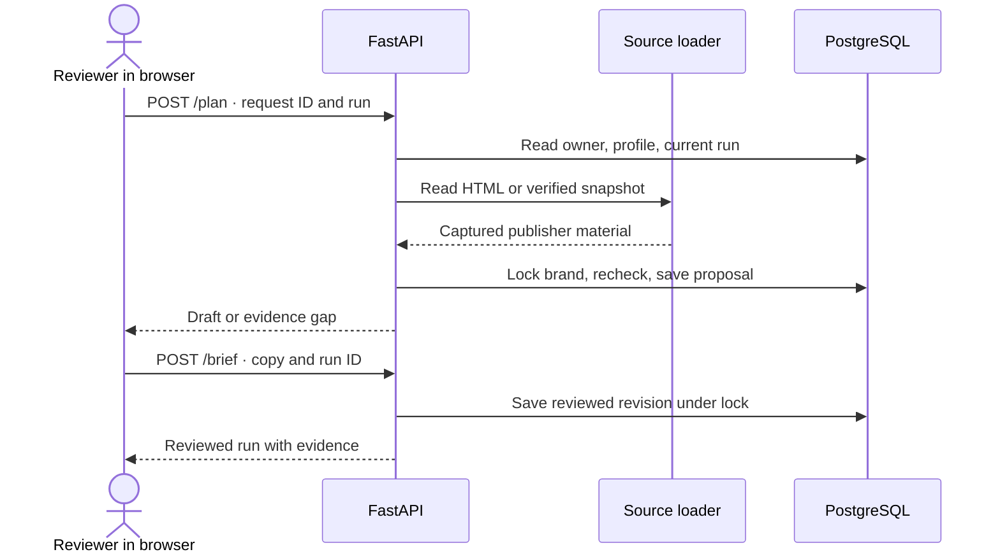
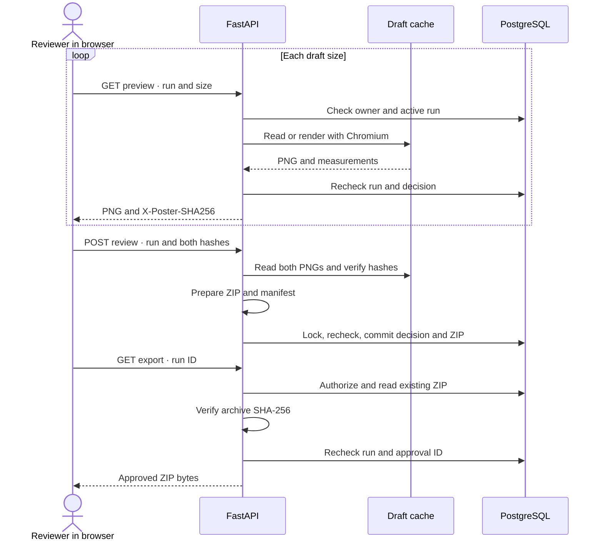

# Campaign architecture and decisions

[Architecture overview](../../images/campaign-architecture/overview.webp) · [Responsive diagram source](../../images/campaign-architecture/diagram.html)

## Planning and review

The diagrams abbreviate routes under `/api/v2/campaigns`. FastAPI authenticates the account before source work. The live loader dials a
validated IP using the publisher's hostname for TLS verification. The snapshot
loader checks captured bytes against a manifest. The planner supports
deterministic copy policies and optional curated editions selected by source,
language, and intent. Completed requests can replay only if the request ID,
inputs, and current run still match. Publisher acquisition happens outside the
write transaction. [API](../../../api/routes/v2_campaigns.py) · [Planner](../../../strategy/campaign_planner.py) · [Transport](../../../scraper/campaign_http.py) · [Snapshot loader](../../../workflows/campaign_snapshot.py)

Evidence includes capture URL/time and hashes, subject, supporting span,
nearby qualifications, and a destination. Spans identify an HTML block and
character offsets in normalized visible text. Readiness checks the seven-day
freshness window. Reviewers assess factual meaning, scope, rights, and the
support for the proposed use. [Evidence representation](../../../strategy/campaign_evidence.py)

## Preview, approval, and delivery

The replaceable draft cache is keyed by run, proposal hash, and size. Chromium
runs on a draft cache miss. Approved previews extract their PNG from the
verified archive. Exports return that archive, whose contents include portrait
and square PNGs, source evidence, review and profile identifiers, and layout
measurements. The approved archive cap is 16 MiB. Corruption blocks delivery.
A historical decision without a bound archive requires a fresh preview and
approval. [Poster package](../../../poster/campaign_package.py) · [Campaign service](../../../db/campaign_v2.py) · [Artifact migration](../../../db/migrations/versions/0009_campaign_artifacts.py)

## Runtime and release boundaries

| Surface | Execution boundary |
| --- | --- |
| Campaign pilot | One FastAPI worker bound to loopback, with PostgreSQL as the authoritative store and a local draft cache. Research in flight lives in the worker. [Operations](OPERATIONS.md) |
| Strategy review | Separate LangGraph workflow with a human interrupt, SQLite checkpoints, and an authoritative PostgreSQL strategy approval. [Application review](../../architecture/app_review.md) |
| Observability | Campaign emits structured redacted events. App deployments can enable redacted Langfuse spans. The pilot disables external telemetry through its isolation setup. [Campaign events](../../../workflows/campaign_telemetry.py) · [Telemetry](../../../workflows/telemetry.py) |
| Showcase artwork | The Buffalo edition refers to stored, reviewed scenes from an earlier Gemini on Vertex AI production step. Chromium assembles the preview from local assets. [Creative provenance](../buffalo/portfolio/REVIEW.md) |
| Release verification | Frozen-case replay, fault tests, and a PostgreSQL/Chromium browser journey run in GitHub Actions. [Executed Campaign workflow](https://github.com/asmaasamyhagag22-design/adzy/actions/runs/43649966314) |

## Decisions

- Preserve the deterministic workflow and existing conservative rewrite rules.
  A new semantic judge would need independently labelled support and usefulness
  evidence. Current model experiments remain advisory.
- For known qualifications, offer a source guide whose copy makes no feature
  promise. Automatic translation of exceptions could omit material conditions.
- Store bounded finalized ZIPs in PostgreSQL for an atomic approval and a single
  backup boundary. External object storage would require a second commit,
  recovery and orphan handling. Preview cache remains replaceable.
- Pin a validated DNS answer at the Campaign socket and keep the original TLS
  hostname. A preflight IP check with an independent fetch leaves the DNS gap.
- Keep a loopback-only, single-worker pilot with one trusted operator, interactive
  account provisioning, no public signup and explicit deployment credentials.
  A network service with tenant isolation and workers sharing one queue is a
  future operating requirement, with durable admission and stronger session
  management needed for that boundary.
- Retain legacy Poster workflows and historical evaluation files as separate
  paths. The Campaign pilot exposes only the selected Campaign and account
  surfaces. This keeps older examples reproducible and reduces pilot exposure.
