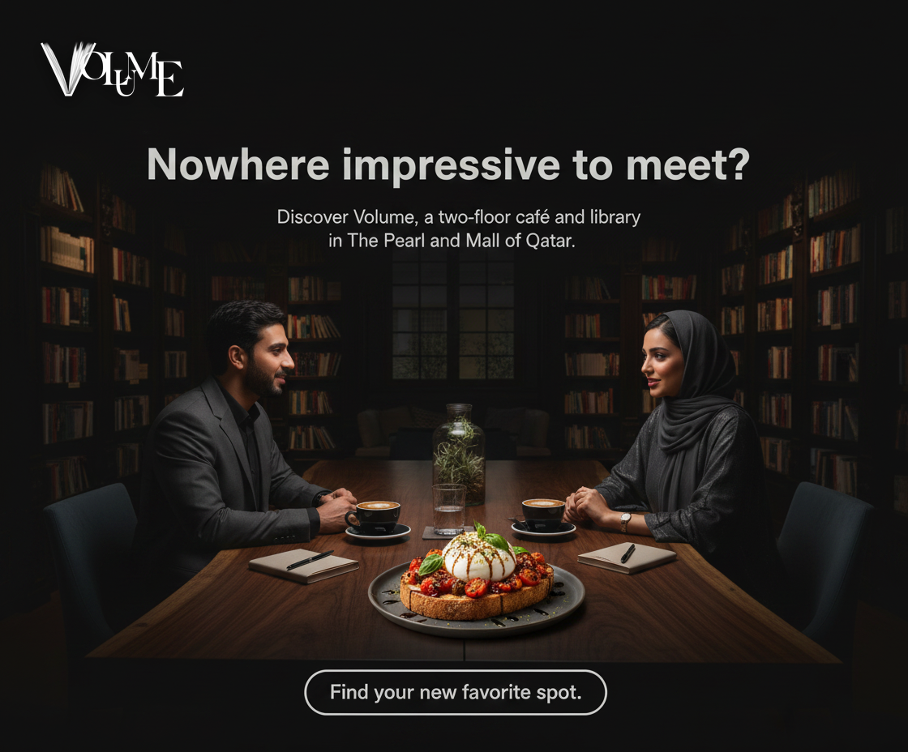
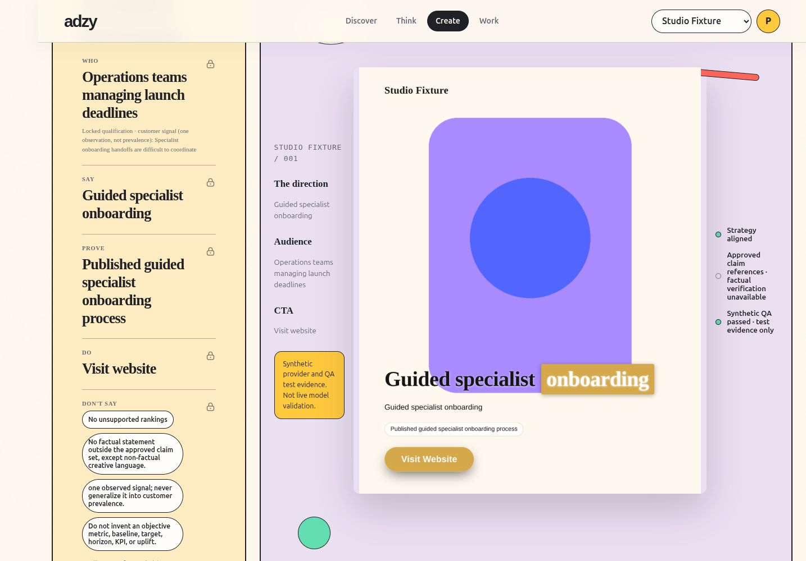

# Generated work and inspectable examples

## Existing poster outputs

These are saved outputs from the existing poster pipeline, copied byte for byte. No new provider generation was run for this presentation. Their [SHA-256 hashes](provenance.json) make the selected images identifiable.

### Arabic: pharmacy app concept

Historical independent design study using the Nahdi brand as input. The delivery wording reflects a captured product-page phrase, `التوصيل للمنزل خلال ساعتين`, at `https://www.nahdionline.com/ar-sa/104010844/pdp/104010844`. That scoped snapshot does not establish a current, brand-wide promise covering every product or location. Treat the artwork as a historical design example and re-review factual copy before reuse.

### English: café and library concept

See the [input and structured evidence excerpt](../../examples/volume-cafe/README.md). The stored evidence supports the Pearl Qatar location; it does not verify the Mall of Qatar mention in this artwork. Generated people and surroundings are illustrative.

Neither concept is presented as commissioned client work, a published campaign, current canonical acceptance, current live QA certification or proof of marketing performance. Brand names identify the demonstration input; no affiliation is claimed.

## Actual application integration

The fictional Studio Fixture journey exercises the real application UI, authentication, PostgreSQL records, canonical compiler, compositor, acceptance boundary and gallery. Collection/provider/vision responses are synthetic. Its poster is an integration output rather than a demonstration of live model quality.

[Download the rendered fixture poster](studio-fixture-poster.png) · [View safe recorded result](studio-fixture-result.json) · [Research screen](../images/synthetic-research.png)

The recorded result binds the saved output to a strategy, CreativeContract and immutable attempt hash. Its QA source explicitly says synthetic test evidence; it is not live factual verification.

## Review behavior observed

The application-triggered graph paused for a decision, survived refresh and a process restart, then resumed the same workflow. PostgreSQL contained one approval for the exact reviewed subject, and the graph returned READY_FOR_CREATIVE with a contract. [Recorded browser evidence](../architecture/app_browser_evidence.json).

[Full verification and remaining limits](../validation/app-review-integration.md) · [Reproduce locally](../getting-started.md)
